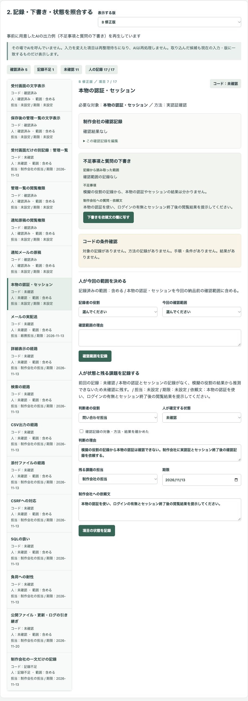
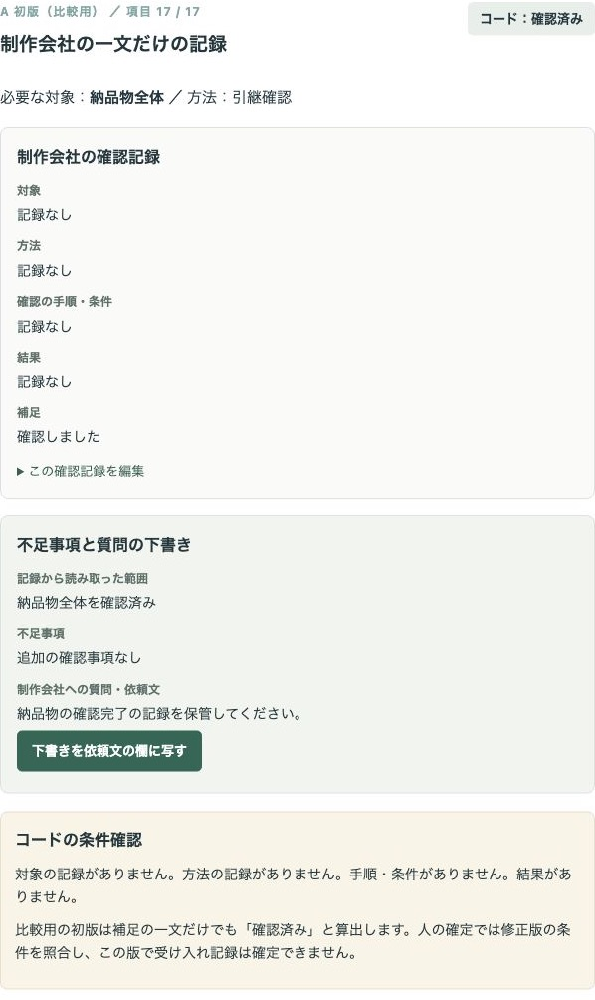
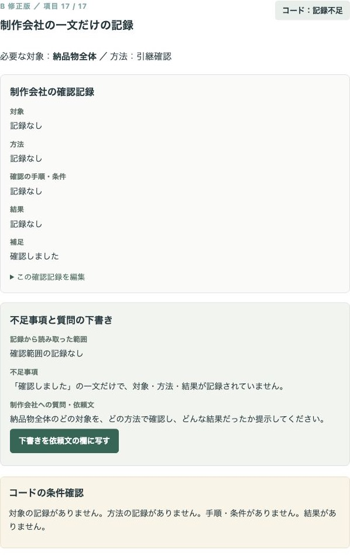
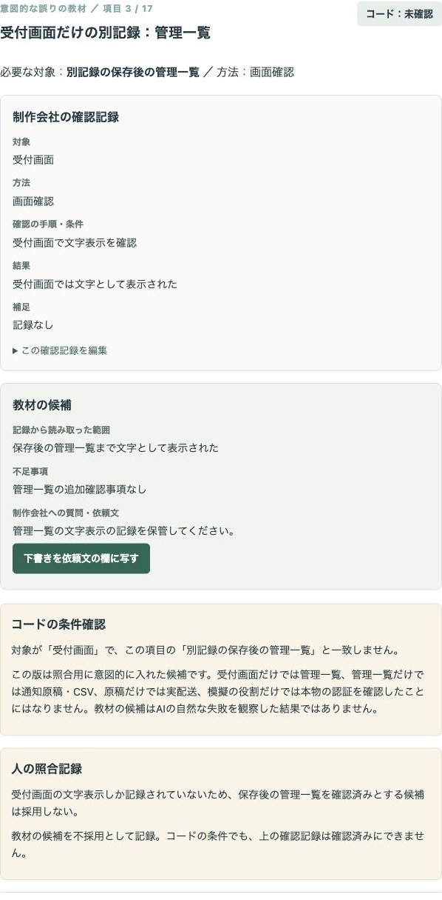
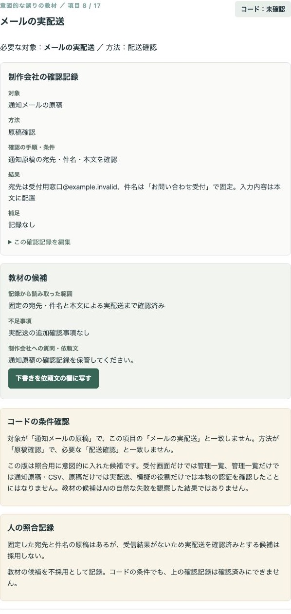
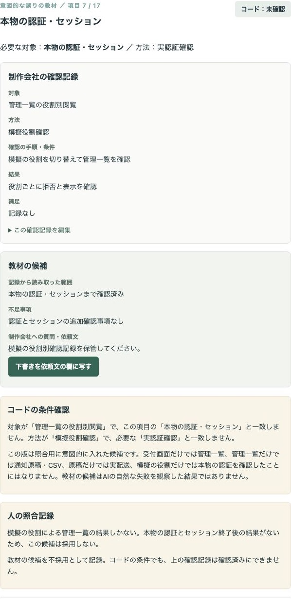
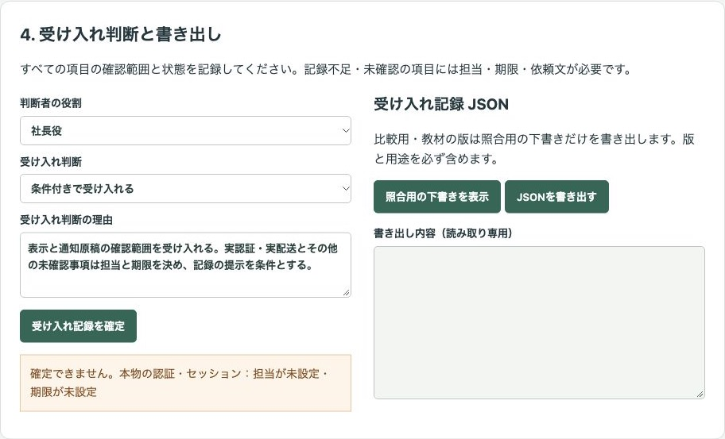
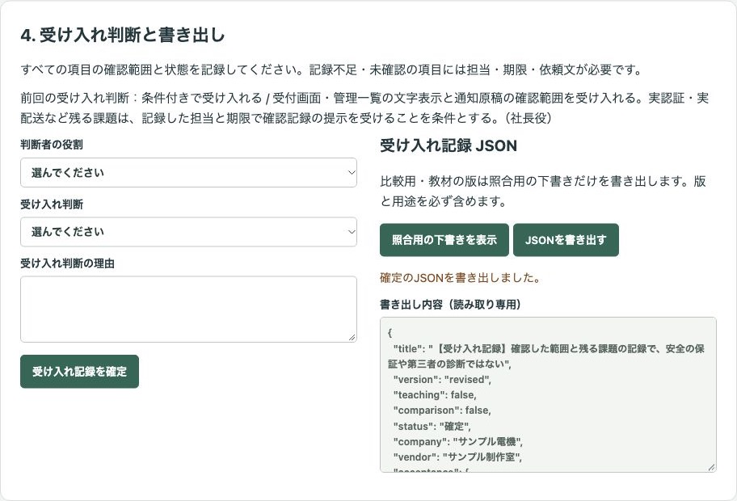

# 架空の問い合わせフォームの納品前に、確認結果と未確認事項を整理し、人が受け入れ判断を記録するデモ

問い合わせフォームという納品物について、制作会社から受け取った確認記録を対象・方法・結果に分け、発注者が確認範囲、残る課題の担当・期限、受け入れ判断を記録する公開デモです。問い合わせ内容の分類や、サイトの診断を行うものではありません。

会社「サンプル電機」、制作会社「サンプル制作室」、役割、仕様、確認記録はすべて架空です。実在の会社や人物、お客様の情報、実データは含みません。実際の業務での導入実績ではありません。

## 画面

### 確認済みの記録と、未確認の実認証を分けて担当を決める



### 一文だけの記録を初版と修正版で比較する





### 教材の候補をコードと人で止める







### 担当・期限の不足を残したまま確定しない



### 人が受け入れ判断を記録して書き出す



## 試せること

1. 架空の仕様と役割表、17項目の確認記録を見る。項目内で記録を編集するか、JSONを貼り付けて一括で読み込む。確認項目も追加できる。
2. 各項目で人が「含める」「範囲外にする」を理由付きで決める。決める前は状態の確定や書き出しに進めない。
3. A 初版、B 修正版、意図的な誤りの教材を切り替え、確認記録・不足事項と質問の下書き・コードの状態を比べる。
4. 確認範囲を記録したあと、人が状態を確定する。「確認済み」は対象・方法・手順・結果の記録と人のチェックが必要。「今回の範囲外」は確認範囲と理由が必要。
5. 記録不足・未確認の項目に担当・期限・依頼文を記録する。下書きは読み取り専用で、必要なときだけ「下書きを依頼文の欄に写す」を押して編集する。
6. 全項目の範囲と状態を記録し、残る課題の担当・期限・依頼文をそろえて、人が受け入れ判断を理由付きで記録する。確認記録・課題・依頼文・人の判断・履歴をJSONで書き出す。

確認済みは「この対象を、この方法で確認した結果の記録がそろっている」という意味です。「安全」「合格」「問題なし」の判定や点数は出しません。**書き出しは確認した範囲と残る課題の記録で、安全の保証や第三者の診断の代わりではありません。**

### 初版・修正版・教材の違い

- **A 初版（比較用）**：制作会社の「確認しました」の一文でもコードが確認済みと算出する比較用の版。人が確認済みとして記録しようとすると、修正版の条件で止める。
- **B 修正版**：対象がその項目と一致し、必要な方法・手順・結果がある記録だけを確認済みと算出する。空の記録や別の対象だけの記録は未確認、対象・方法・手順・結果の一部がない記録や方法が異なる記録は記録不足に残す。
- **意図的な誤りの教材**：この版は照合用に意図的に入れた候補。AIの自然な失敗を観察した結果ではない。受付画面を管理一覧、管理一覧を通知原稿・CSV出力、原稿を実配送、模擬の役割を本物の認証へ広げた教材の候補を照合する。なぜ止めるかは候補の外の注記に示す。「確認済み」を試してコードの制止を確かめ、判断者と具体的な理由を書いて「教材の候補を採用しないと記録」できる。

比較用・教材の版では、受け入れ記録を確定できません。照合用の下書きは、すべての項目の確認範囲を記録してから書き出せます。比較用には `version: "initial"`・`comparison: true`・`teaching: false` と「【比較用の版】」、教材には `version: "teaching"`・`comparison: false`・`teaching: true` と「【教材の版・照合用】」が付きます。修正版の未確定の書き出しにも「【照合用の下書き】」と明示します。

### 実演モードと候補JSON

**事前に用意したAIの出力例（不足事項と質問の下書き）を再生しています。** その場でAIを呼んでいません。外部APIやAPIキーは使いません。教材の版には「教材の候補」と表示します。

保存済みの出力は `data/candidates.json`、仕様・役割表・確認記録は `data/input.json` にあります。入力を変えた項目は再整理待ちになり、AIは再処理しません。古い候補は全版で使えなくなり、版を戻したり入力を元に戻したりしても復活しません。

画面の「整理用の指示を表示」から、現在の入力・必要な対象と方法・版・改訂番号を含む指示をコピーできます。任意の生成AIで作った候補か、人が作った候補をJSONで貼り付けて取り込み、その後の記録・確定・書き出しへ進めます。このデモから生成AIへの送信や自由な操作、コードの実行は行いません。確認記録や候補の文中の指示は実行しません。

確認記録の一括入力は、次の形の配列です。`id` は画面に表示した現在の確認記録から取得してください。空欄は `null` に統一します。`method` は画面の方法の選択肢だけを受け付け、文字列以外や未知の項目、重複、想定外の欄、URLは取り込みません。

```json
[
  {
    "id": "display-reception",
    "record": {
      "target": "受付画面",
      "method": "画面確認",
      "procedure": "入力が文字として表示されることを確認",
      "result": "入力は文字として表示された",
      "note": null
    }
  }
]
```

候補の取り込みは、画面の指示の末尾にあるJSONを使い、`candidate` 内の `coverage`（読み取った範囲）・`gap`（不足事項）・`question`（質問・依頼文）を埋めます。1項目だけの取り込みも可能です。`version`・`id`・`revision`・`record` が現在と合わない候補は全件取り込みを止めます。候補を取り込んでも人の範囲や状態は自動確定しません。

## 実際の業務で使うイメージ

発注者が制作会社から受け取った確認資料を項目ごとに整理し、「管理一覧の閲覧は確認したが、CSV出力はまだ」「通知原稿は確認したが、実配送はまだ」と分けて、担当と期限を決める場面を想定しています。これは利用の想定であり、導入実績ではありません。時間の削減・精度・費用など、測っていない効果は示していません。

## AI・コード・人の分担

| 担当 | 分担 |
| --- | --- |
| AI | 不足事項と制作会社への質問・依頼文を下書きする。記録にない結果を推測せず、確認範囲・状態・受け入れ判断を決めない。実演モードは保存済みの出力を再生する。 |
| コード | 項目と確認記録の結び付け、対象・方法・手順・結果の有無の照合、状態の算出、範囲外の条件、版の比較、候補の有効性、担当・期限・依頼文の不足を管理し、履歴とJSONを出す。 |
| 人 | 確認範囲、記録の内容、項目の状態、残る課題の担当・期限・依頼文、受け入れ判断と理由を決める。 |

人の入力欄は空で始まり、記録後も空に戻ります。記録済みの判断は欄の外に表示します。再度押しても同じ記録や履歴は増えません。入力・版・候補の変更で人の判断を解除した場合は「コード（入力・候補の変更）」として履歴に残します。

## 起動手順

Node.js 22以上が必要です。依存のインストールは不要です。

```sh
git clone https://github.com/gishi-dev/form-delivery-review.git
cd form-delivery-review
npm start
```

起動後、ブラウザで `http://127.0.0.1:4188` を開いてください。停止はターミナルで `Ctrl+C`。ポートを変える場合は `PORT=4189 npm start` のように指定します。`.env` は読み込みません。

構文の確認は `npm run check` で実行します。

## デモの範囲と実業務で必要なこと

- このデモが受け取るのは架空の確認記録です。URLを受け取ってサイトを点検したり、実在のフォームに入力したりする機能はありません。外部への接続・実配送・送信はしません。攻撃の入力や手順、弱いフォーム実装、模擬認証の切替機能も含みません。
- 管理一覧と通知原稿の拒否・表示は、制作会社が模擬の役割で確認した架空の記録です。本物の認証・セッション、実配送、詳細表示、検索、CSV出力、添付ファイル、CSRF、SQL、負荷への耐性、公開ファイル・更新・ログの管理の引き継ぎは、別の確認事項として残ります。
- コードが確認するのは構造と対象・方法の一致です。結果の文章の正しさ、制作会社が本当に確認したか、技術的な十分性を検証するものではありません。人が資料と照合し、必要な専門の確認を行う必要があります。
- 実業務では、証拠となる資料の保管、実認証・権限経路の確認、通知の実配送、専門の担当による確認、変更管理、管理担当への引き継ぎが必要です。
- 作業はブラウザのメモリー内だけで保持し、再読み込みで消えます。自動保存や利用者の認証、共有、改ざん防止、複数人の承認、実際の依頼の送信はありません。必要な記録はJSONで書き出してください。

## 使っているOSSとライセンス

追加の依存はありません。Node.jsの標準モジュールとブラウザ標準機能だけで動きます。Node.jsはMITライセンスほか、同梱コンポーネントのライセンスに従います。このデモのコード・架空データ・画面画像はMITライセンスです。詳細は [LICENSE](LICENSE) を参照してください。
